<div align="center">


# kiorex-platform

**The Kiorex patient marketplace: web, mobile, ops console and the Kiorex API.**
Real slots from real clinics, deposits through Kiorex Pay, verified reviews, and the feature-flag control plane.


[Quick start](#quick-start) · [Architecture](#architecture) · [Flows](#key-flows) · [Screens](#screens) · [Docs](#where-to-read-next) · [Ecosystem map](https://github.com/mshall/kiorex-workspace)

</div>

> **Synthetic data only.** QA personas, logins and reset steps: [Docs/TEST_DATA.md](Docs/TEST_DATA.md) (DEV ONLY).

---

## What and why

Kiorex is the patient side of the ecosystem. Patients find a verified doctor, pick a **live slot from the clinic's own schedule**, pay a deposit and get reminders. Kiorly Clinic stays the only system of record for appointments (ADR-005); this platform books against it with holds and idempotency keys, keeps its own money ledger (Kiorex Pay), and runs the **control plane** that lets the super admin switch any capability on or off per market or organisation. One NestJS modular monolith serves the patient web app, the Expo app and the ops console.

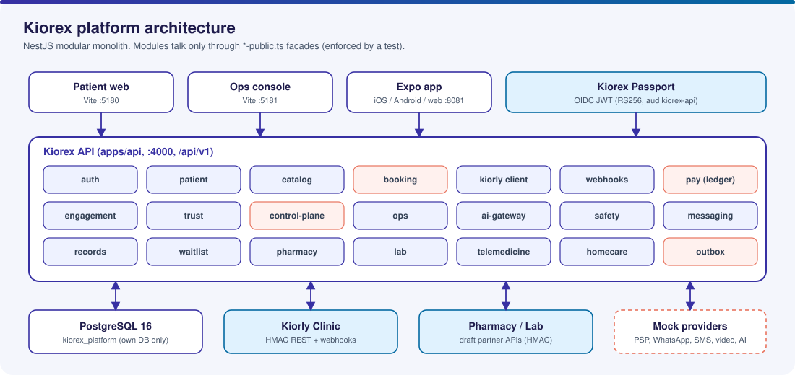

## At a glance

| | |
|---|---|
| **API** | NestJS 10 + Prisma 6 + PostgreSQL 16, `:4000`, prefix `/api/v1`, 56 tables, 21 bounded modules |
| **Apps** | Patient web (Vite, `:5180`), ops console / super admin (`:5181`), Expo app (`:8081`) |
| **Languages** | Arabic and English, RTL verified; Jost + IBM Plex Sans Arabic |
| **Identity** | Kiorex Passport OIDC (auth code + PKCE), JWT RS256 with `aud=kiorex-api` |
| **Talks to** | Kiorly Clinic (HMAC REST + webhooks), Pharmacy and Lab (partner APIs), Passport (OIDC) |
| **Money** | Idempotency key + outbox event + ledger entry + reconciliation on every path |
| **Providers** | All mocked (`MODE=mock`): messaging, PSP (`sandbox-fake`), video, maps, AI |
| **Standing rule** | No tax-authority reporting, ever (ADR-011); a test enforces it |

## Features

| Area | What patients and ops get | Status |
|---|---|---|
| Discovery | Search by specialty, doctor or clinic, map with clustering, next slots inline | :white_check_mark: |
| Booking | Hold, confirm with `Idempotency-Key`, reschedule, cancel by policy | :white_check_mark: |
| Deposits | Kiorex Pay, refunds, pay links, weekly payouts, double-entry ledger | :white_check_mark: mock PSP |
| Waitlist | Join only when full; autofill offers on freed slots | :white_check_mark: |
| Reviews | Verified-visit reviews, moderation, aggregates synced to Kiorly | :white_check_mark: |
| Records | Patient vault, shared records, prescription QR, follow-ups | :white_check_mark: |
| Family | Dependants and guardians via Passport, family shares | :white_check_mark: |
| Home visits and care plans | Address book, coverage, nurse timeline, safety console | :lock: launch-locked (gates GHV1/2) |
| Pharmacy, Lab, Telemedicine | Orders, bookings and sessions through partner services | :lock: launch-locked |
| AI navigation | Gateway with PHI redaction, labels and quota | :lock: launch-locked, fake provider |
| Control plane | Flag registry, gates, two-person rule, audit, signed snapshots, push | :white_check_mark: |
| Ops console | Directory, timeline, outbox replay, finance, moderation, messaging, safety | :white_check_mark: |

## Architecture

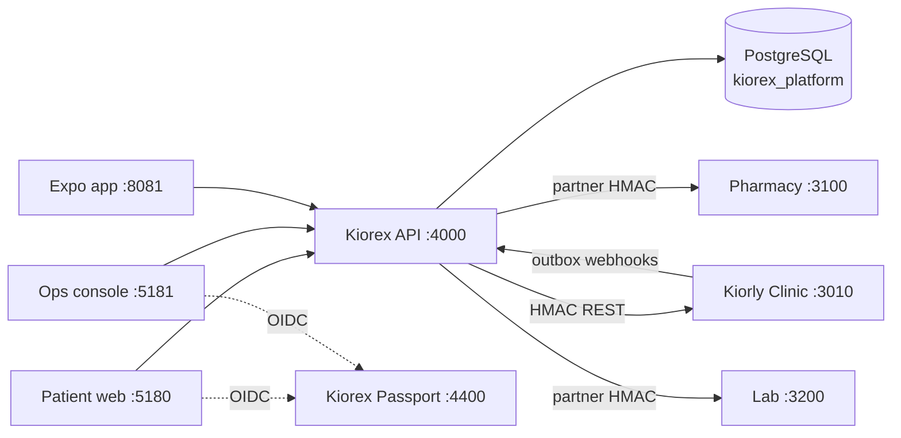

### Key flows

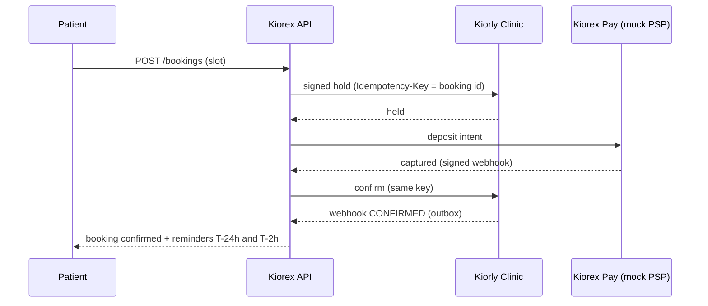

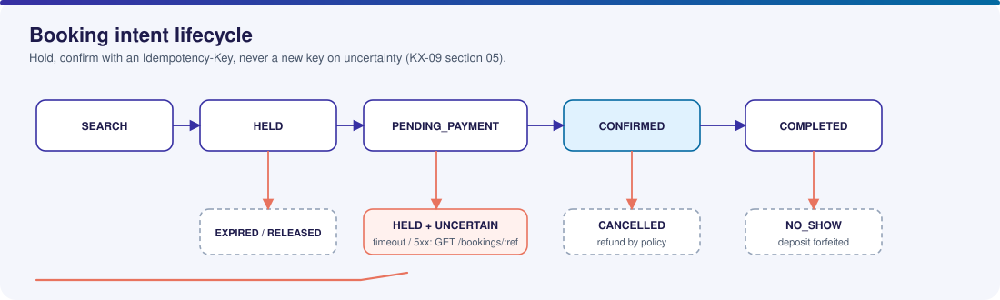

<details>
<summary><b>Money and ledgers</b></summary>

Integer minor units; three ledgers never commingled. Accounts: `PSP_CLEARING`, `HELD:<clinic>`, `PAYABLE:<clinic>`, `REFUND_PAYABLE`, `PSP_FEES`, `MARKETPLACE_FEES`. Capture goes to HELD; COMPLETED or NO_SHOW moves it to PAYABLE; the weekly payout drains PAYABLE and calls Kiorly. Captured-but-booking-dead triggers an automatic refund. The database enforces single-sided entries and a deferred balanced-transaction trigger. Deposits held for review (home-visit unsafe abort) are never moved automatically.
Detail: [Docs/ARCHITECTURE.md](Docs/ARCHITECTURE.md).
</details>

<details>
<summary><b>Feature flags (control plane)</b></summary>

Every capability ships ON and can be switched OFF from the super admin at global, market or org scope (ADR-023). OFF answers `403 FEATURE_DISABLED {key, scope}` and never hides data. Launch-locked flags work only with human-recorded gate evidence (ADR-024). Safety controls are never flags (ADR-025). Products poll the signed snapshot every 30 s with ETag and also get `flag.changed` pushes. Application code never records a gate.
</details>

## Data model overview

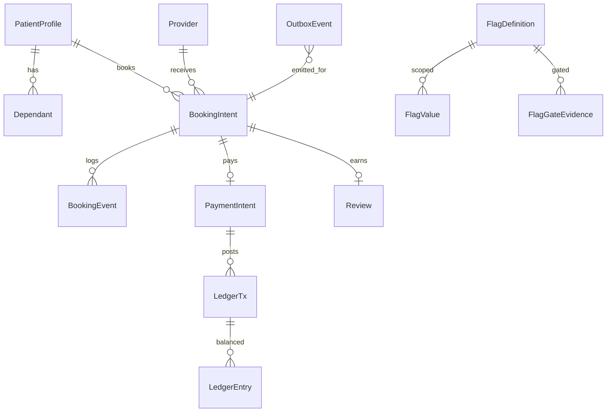

56 Prisma models in [`apps/api/prisma/schema.prisma`](apps/api/prisma/schema.prisma); migrations in `apps/api/prisma/migrations`.

## Screens

Captured from the running apps with synthetic data (light theme, English). Arabic and dark variants are in the workspace UI review.

| Patient web | Patient web | Patient web |
|---|---|---|
| 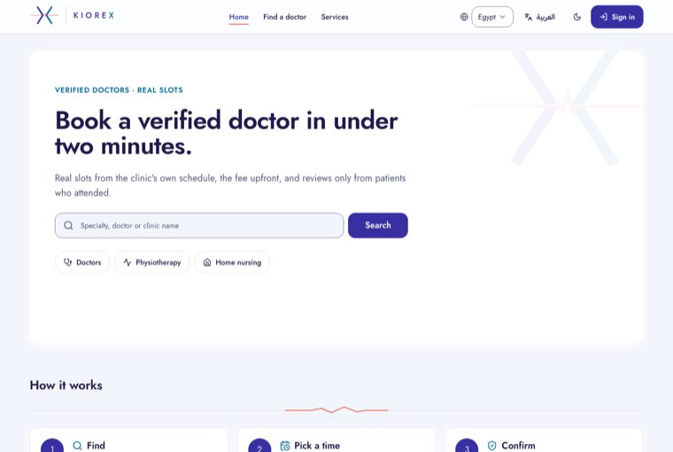 | 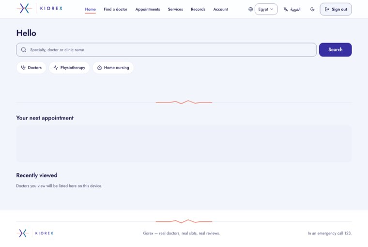 | 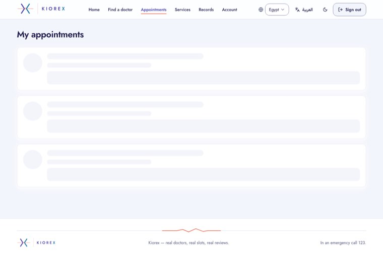 |

| Expo app | Expo app | Ops console (mockup) |
|---|---|---|
| 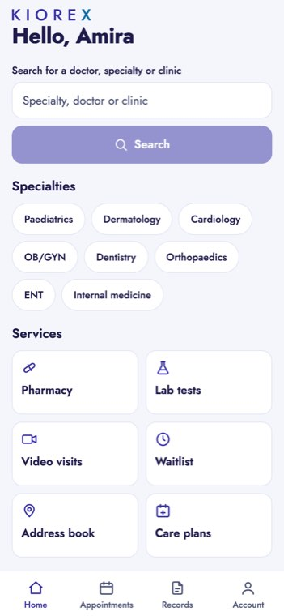 | 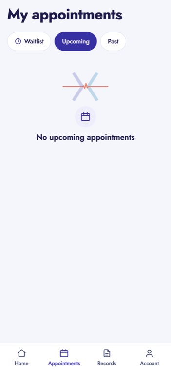 | 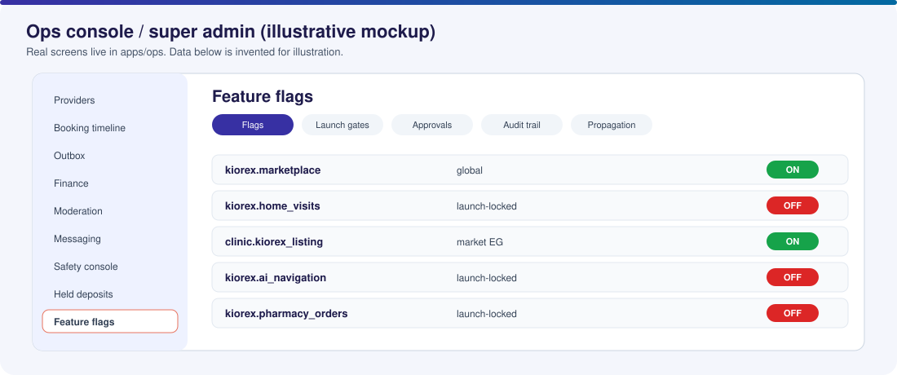 |

## Quick start

Prerequisites: Node 20+, Postgres on `:5433` (workspace cluster; see the [workspace README](https://github.com/mshall/kiorex-workspace)), a sibling `kiorex-contracts` (or the vendored tarball in `vendor/`).

```bash
npm install
cp apps/api/.env.example apps/api/.env       # never commit .env
npm run db:deploy -w apps/api                # prisma migrate deploy
npm run db:seed   -w apps/api                # flag registry + dev product keys (no providers, no gate evidence)
npm run dev                                  # api :4000 + web :5180 + ops :5181
```

| Service | URL | Command |
|---|---|---|
| Kiorex API | http://localhost:4000/api/v1 | `npm run dev -w apps/api` |
| Patient web | http://localhost:5180 | `npm run dev -w apps/web` |
| Ops console | http://localhost:5181 | `npm run dev -w apps/ops` |
| Expo web | http://localhost:8081 | `npm run mobile:web` |
| Passport (needed to sign in) | http://localhost:4400 | `npm run dev` in `kiorex-account` |

Full local stack (Passport, Kiorly, Kiorex, Pharmacy, Lab) and demo data: see the workspace README (`e2e/scripts/up.sh`, `scripts/seed-all.sh`).

## Tests

```bash
npm run lint && npm run typecheck && npm test          # all workspaces
npm run test:unit -w apps/api                          # unit
npm run test:integration -w apps/api                   # against kiorex_platform_test, migrations auto-applied
npm run test:flag-off -w apps/api                      # every flag-OFF contract (403 FEATURE_DISABLED)
npm run test:contract -w apps/api                      # OpenAPI contract against live responses
npm run openapi:export -w apps/api                     # regenerate OpenAPI + Docs/API.md (commit both)
npm run mobile:test                                    # Expo app
```

Guards worth knowing: `no-tax-authority.unit.spec.ts` (fails on any tax-authority client) and `module-boundaries.unit.spec.ts` (modules import each other only through `*-public.ts`).

## Environment variables

Full list in [`apps/api/.env.example`](apps/api/.env.example) (values are dev defaults, never reuse in staging or production).

| Variable | Purpose | Default (dev) |
|---|---|---|
| `PORT`, `DATABASE_URL` | API port and Postgres | `4000`, workspace cluster |
| `OIDC_ISSUER`, `OIDC_AUDIENCE` | Passport issuer and expected audience | local Passport, `kiorex-api` |
| `KIORLY_BASE_URL`, `KIORLY_CLIENT_KEY/SECRET`, `KIORLY_WEBHOOK_SECRET` | Kiorly marketplace client and webhook secret | dev values from workspace `INTEGRATION.md` |
| `PSP_MODE` | `sandbox-fake` locally; real PSPs need onboarding | `sandbox-fake` |
| `MESSAGING_MODE`, `VIDEO_MODE`, `STORAGE_MODE`, `AI_PROVIDER` | Provider adapters | `mock` / `fake` |
| `FIELD_ENCRYPTION_KEY` | AES-256-GCM key for national ID at rest | dev only; KMS in production |
| `DEPOSIT_DEFAULT_MINOR`, `PSP_FEE_BPS`, `*_TAKE_RATE_BPS` | Pricing placeholders (NEEDS_HUMAN) | `0` |
| `JOBS_ENABLED` | Background jobs (sync, outbox, reminders) | `true` (false in tests) |

## Folder map

```text
kiorex-platform/
├── apps/
│   ├── api/       NestJS API, Prisma schema and migrations, OpenAPI  (apps/api/README.md)
│   ├── web/       patient web, Vite :5180                            (apps/web/README.md)
│   ├── ops/       ops console and super admin, Vite :5181            (apps/ops/README.md)
│   └── mobile/    Expo app (Expo Router)                             (apps/mobile/README.md)
├── Docs/          INDEX, API, ARCHITECTURE, RUNBOOK, NEEDS_HUMAN ... (Docs/INDEX.md)
├── infra/         OpenTofu stacks and the demo-seed Lambda           (infra/README.md)
├── scripts/       seed-demo.sh, seed-staging.sh, vendor-contracts.sh
├── vendor/        vendored @kiorex/contracts tarball for CI
└── platform/      data-cells.json, waf-rules.json
```

## Deployment overview

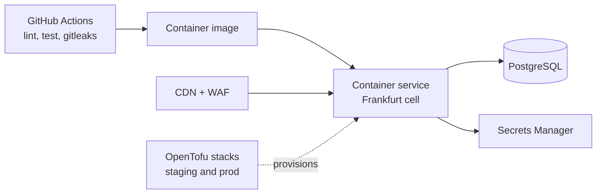

Infrastructure is **OpenTofu only** (ADR-028). Nothing has been applied: `tofu fmt` and `validate` run locally; **no deploy to AWS until the founder says so**. See [infra/README.md](infra/README.md).

## Security notes

- No PHI in logs or analytics; national ID is AES-256-GCM encrypted with a blind index.
- No secrets, `.env` or build output in git; CI runs gitleaks. Product flag secrets and the Kiorly client secret rotate per environment.
- `@aws-sdk/*` is allowed only inside `src/platform/adapters/*`.
- Messaging, PSP, video and AI run on mock adapters; real providers are wired in a dedicated pre-launch pass, staging first.
- **No tax-authority integration** of any kind (ADR-011). VAT is only a configurable line on Kiorex's own fee statements.

## Where to read next

| Read | For |
|---|---|
| [Docs/INDEX.md](Docs/INDEX.md) | Index of every document here |
| [Docs/ARCHITECTURE.md](Docs/ARCHITECTURE.md) | Modules, boundaries, money, booking consistency |
| [Docs/RUNBOOK.md](Docs/RUNBOOK.md) | Run locally, seeds, jobs, outbox replay, reconciliation |
| [Docs/API.md](Docs/API.md) | Every route (generated) |
| [Docs/NEEDS_HUMAN.md](Docs/NEEDS_HUMAN.md) | Open decisions and STOP flags |
| [Docs/VERTICALS.md](Docs/VERTICALS.md) | Pharmacy, Lab, telemedicine design notes |
| [Docs/DESIGN_SYSTEM.md](Docs/DESIGN_SYSTEM.md) | Brand tokens, components, RTL |
| [Docs/CONTRACTS_DISTRIBUTION.md](Docs/CONTRACTS_DISTRIBUTION.md) | How `@kiorex/contracts` reaches this repo |
| [Docs/TEST_DATA.md](Docs/TEST_DATA.md) | Synthetic QA data |
| [Docs/kiorex-cursor-build-sequence.md](Docs/kiorex-cursor-build-sequence.md) | Build steps and progress |

## Contributing

`main` is the working branch; open a pull request for review (CODEOWNERS applies). Use Conventional Commits with requirement IDs, for example `feat(booking): KXM-BK-03 idempotent confirm`. Run `npm run lint && npm run typecheck && npm test` first. Stop and ask a human for prices, fees, VAT or refund policy that is not specified, legal or clinical wording, marking a launch gate satisfied, production credentials, and breaking a published contract. Never deploy or push infra changes without founder approval.

## Glossary

| Term | Meaning |
|---|---|
| **Hold** | Temporary reservation of a slot at Kiorly before payment and confirm |
| **Outbox** | Table written in the same transaction as a change, dispatched reliably to other systems |
| **Control plane** | Super admin and registry that owns feature flags |
| **Launch gate** | Human-recorded evidence that unlocks a launch-locked flag |
| **Kiorex Pay** | Kiorex's own deposit and payout ledger |
| **Passport** | Kiorex Passport, the OIDC identity service (repo `kiorex-account`) |

<div align="center"><sub>Private repository. Part of <a href="https://github.com/mshall/kiorex-workspace">Kiorex v2</a>.</sub></div>
