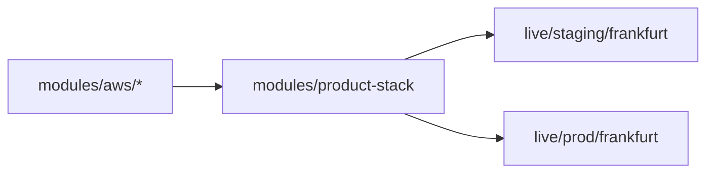

# infra

Infrastructure as code for Kiorex Platform. **OpenTofu only** (ADR-028). **Nothing has been applied**; do not deploy until the founder approves. Back to the [platform README](../README.md).

| Path | What |
|---|---|
| [tofu/](tofu/README.md) | Modules (network, database, container service, CDN, WAF, secrets, observability, CI OIDC) and live stacks for staging and prod (Frankfurt) |
| `lambda/demo-seed/` | Lambda used to seed demo data into staging (non-production only, guarded) |

Local checks only: `tofu fmt -check -recursive && tofu validate` inside a live stack directory. State is in S3 with client-side KMS encryption; the bootstrap lives in `clinics-management/infra/tofu/bootstrap`.
